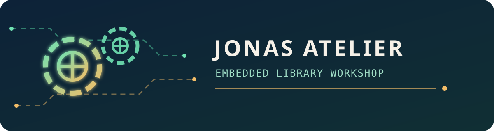

  

<h1 align="center">Jonas Atelier</h1>

  Hi, I'm Jonas Chan — a robotics hobbyist. I build robots in my spare
  time, and the firmware they run on.

  
  
  
  
  
  

  Drivers for the parts robots are actually built from — motors and encoders,
  sensing, power, buses. Plain C. The control and filter libraries are one
  header and one source file; the drivers are category libraries that build
  unchanged on ESP-IDF and the STM32 HAL.

  Every register value is traced to a line in the datasheet, and the comment
  next to it says which one. Where a vendor does not publish a register map,
  the README says so rather than pretending otherwise.

  Chips of one kind share one library, <code>mcu-imu</code>,
  <code>mcu-baro</code>, <code>mcu-can</code> and fourteen more, built the way
  Linux IIO is: every chip probes into the same <code>struct imu_dev</code>,
  <code>struct baro_dev</code> or <code>struct can_dev</code> and reads out
  one shape, so swapping the part never touches the code above it — and the
  same code runs on an ESP32 and an STM32.

  ✅ Available · 🧪 Hardware validation · 🚧 On-going

<pre>
├── 🔌 ESP32 + STM32 — one library per kind of chip
│   ├── mcu-imu            — MPU-6050, ICM-45686, BMI088, WT901C-TTL    🧪
│   ├── mcu-compass        — QMC5883L/P, IST8310, LIS3MDL, CMPS14       🧪
│   ├── mcu-baro           — BMP280, BMP388, DPS310, MS5611             🧪
│   ├── mcu-encoder        — AS5047P, AS5600, AMT102-V                  🧪
│   ├── mcu-powermon       — INA219, INA226, INA228, INA237             🧪
│   ├── mcu-battery        — MAX17048 fuel gauge, BQ76920/30/40 BMS     🚧
│   ├── mcu-stepper        — TMC2209, TMC5240                           🧪
│   ├── mcu-esc            — DJI C610, C620, GM6020, C615; Haitai HT-03 🧪
│   ├── mcu-servo          — Hobby servos on MCU PWM or a PCA9685       🧪
│   ├── mcu-loadcell       — HX711, NAU7802                             🧪
│   ├── mcu-tof            — VL53L1X, TF-Luna                           🧪
│   ├── mcu-lidar          — LDROBOT LD19, LD06                         🧪
│   ├── mcu-uwb            — DW1000 two-way ranging                     🧪
│   ├── mcu-can            — MCP2515, ESP32 TWAI, STM32 bxCAN           🧪
│   ├── mcu-rc             — CRSF/ELRS, SBUS, DJI DR16                  🧪
│   ├── mcu-gamecontroller — DualShock 4, DualSense, Xbox over BLE      🧪
│   └── mcu-expander       — MCP23017, MCP23S17                         🧪
│
├── 🔨 Build
│   ├── esp-forge — ESP32 firmware, pinned parts and ESP-IDF v5.5.5         🚧
│   └── stm-forge — STM32 firmware, pinned parts and ARM GNU 14.2.rel1      🚧
│
├── 🤖 On the bench
│   ├── hawk         — Quadcopter flight controller, STM32F405       🚧
│   ├── nexus_p      — Hawk power-board monitor, STM32G030           🚧
│   ├── nova_s3      — Swerve module, ESP32-S3, M3508 over dual CAN  🚧
│   ├── flux_s3      — Sensored FOC, ESP32-S3, DRV8323 + AS5047P     🚧
│   ├── dingo_s3     — Dingo quadruped on ESP32-S3, 12 servos        🚧
│   └── rmboard_f427 — RoboMaster Board A bring-up, STM32F427        🚧
│
├── ⚡ ESP32 / ESP-IDF
│   ├── esp-c620-control       — RoboMaster M3508 / C620 motor control  🧪
│   ├── esp-drv8323-gatedriver — DRV8323 three-phase gate driver        🚧
│   ├── esp-ads1115-adc        — ADS1115 16-bit ADC                     🧪
│   ├── esp-ssd1306-oled       — SSD1306 OLED                           🧪
│   ├── esp-ws2812-led         — WS2812 LEDs over RMT                   🚧
│   ├── esp-sn65hvd230-can     — Classic CAN over TWAI                  ✅  <a href="https://github.com/JonasAtelier/esp-sn65hvd230-can">🔗</a>
│   ├── esp-espnow-link        — ESP-NOW packets between boards         🚧
│   ├── esp-ota-wifi           — On-demand Wi-Fi OTA                    🧪
│   └── esp-sdlog              — Buffered SD-card logger                🚧
│
├── 🐧 Linux
│   ├── nv-ps-controller — PS4 / PS5 pads on NVIDIA Jetson       🚧
│   └── Robust           — ROS 2's model, in plain C, one device 🚧
│
└── 🧰 General
    ├── upid            — Portable PID control                 ✅  <a href="https://github.com/JonasAtelier/upid">🔗</a>
    ├── adrc            — Active disturbance rejection control 🚧
    ├── lqr             — Discrete-time LQR gains              🚧
    ├── foc             — Field-oriented control maths         🧪
    ├── fsm             — Table-driven finite state machines   🧪
    ├── bt              — Behaviour trees                      🚧
    ├── kin             — Forward / inverse kinematics         🧪
    ├── dyn             — Arm dynamics, recursive Newton-Euler 🚧
    ├── mob             — Wheel kinematics &amp; odometry          🚧
    ├── path            — Spline path &amp; pure pursuit           🚧
    ├── imp             — Impedance &amp; admittance control       🧪
    ├── f_kalman        — Scalar Kalman filter                 🧪
    ├── f_complementary — Complementary filter                 🧪
    ├── f_particle      — Particle filter                      🧪
    ├── f_madgwick      — Madgwick AHRS filter                 🚧
    ├── f_ekf           — Extended Kalman filter               🚧
    └── f_rls           — Recursive least squares              🚧
</pre>

  

  Everything here is plain C. The control and filter libraries are one header
  and one source file; the drivers build unchanged on ESP-IDF and the STM32 HAL.
   
  Projects become clickable after hardware validation and public release.

  <a href="https://github.com/JonasAtelier/jonas-atelier-libraries"><b>Full catalog, including what is coming →</b></a>

